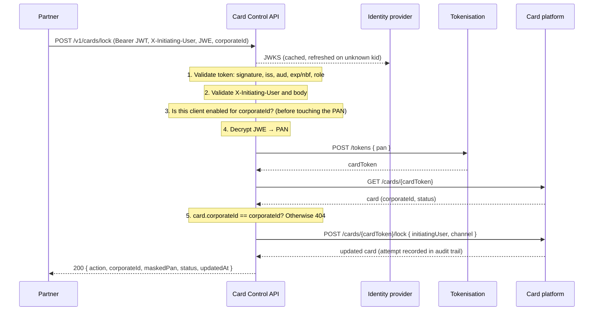

# Partner Card Control API

An ASP.NET Core (.NET 10) API that an external partner platform calls to **lock and unlock** a bank's corporate credit cards. It validates the partner's OAuth access token and decrypts the card number (PAN), which arrives as a JWE. It then checks that the partner is entitled to the card's corporate, exchanges the PAN for a card token, and asks the card platform to make the change, passing along the person who initiated it for the audit trail.

The exercise is in [candidate-brief.md](candidate-brief.md). The starter kit's documentation, covering the stubs' APIs and seed data, is in [STARTER-KIT.md](STARTER-KIT.md).

- [Quick start](#quick-start)
- [API](#api)
- [How it works](#how-it-works)
- [Tests](#tests)
- [Assumptions](#assumptions)
- [Shortcuts and what I'd do with more time](#shortcuts-and-what-id-do-with-more-time)
- [Changes to the starter kit](#changes-to-the-starter-kit)
- [Time spent](#time-spent)
- [Use of AI tools](#use-of-ai-tools)

---

## Quick start

You need the **.NET 10 SDK**. Run everything from the repository root.

```bash
# Once: create the bank's dev key pair in .dev-keys/ (git-ignored). The API won't start without it.
dotnet run tools/jwe-tool.cs -- keygen

# Four terminals:
dotnet run --project mock-identity-provider --urls http://localhost:5090
dotnet run --project tokenisation-stub      --urls http://localhost:5070
dotnet run --project card-platform-stub     --urls http://localhost:5080
dotnet run --project src/CardControl.Api    --launch-profile http        # http://localhost:5190
```

### Sample call

The quickest way is the sample script. It plays the partner: it gets a token, encrypts a PAN with the starter kit's tool, locks and then unlocks the card, and prints the card platform's audit trail.

```powershell
./scripts/sample-call.ps1                                         # Windows PowerShell 5.1 or PowerShell 7
./scripts/sample-call.ps1 -Pan 4000002500003155 -CorporateId CORP-3003   # a refused one
```
```bash
./scripts/sample-call.sh                                          # bash; no jq needed
./scripts/sample-call.sh 4012888888881881 CORP-2002
```

Or by hand (PowerShell; the bash equivalents are in [STARTER-KIT.md](STARTER-KIT.md#quick-start)):

```powershell
$TOKEN = (Invoke-RestMethod -Method Post -Uri http://localhost:5090/oauth2/token -Body @{
  grant_type = 'client_credentials'; client_id = 'partner-app'
  client_secret = 'dev-only-partner-app-secret'; scope = 'api://card-control/.default'
}).access_token
$PAN_JWE = dotnet run tools/jwe-tool.cs -- encrypt --key .dev-keys/bank-dev-1.public.pem 4111111111111111

Invoke-RestMethod -Method Post -Uri http://localhost:5190/v1/cards/lock `
  -Headers @{ Authorization = "Bearer $TOKEN"; 'X-Initiating-User' = 'jane.smith@acme.example' } `
  -ContentType 'application/json' -Body (@{ encryptedPan = $PAN_JWE; corporateId = 'CORP-1001' } | ConvertTo-Json)
```
```json
{ "action": "Lock", "corporateId": "CORP-1001", "maskedPan": "411111******1111", "status": "Locked", "updatedAt": "2026-11-24T17:10:30.07+00:00" }
```

[src/CardControl.Api/CardControl.Api.http](src/CardControl.Api/CardControl.Api.http) has the main success and error cases ready to send from Visual Studio, VS Code (REST Client) or Rider, plus fault-injection calls for the card platform. The OpenAPI document is at `http://localhost:5190/openapi/v1.json` in Development.

### Run the tests

```bash
dotnet test
```

The tests don't need any of the services running. One test runs the real `tools/jwe-tool.cs`, so it needs `dotnet` on the PATH.

### End-to-end check against the real services

```powershell
./scripts/e2e-check.ps1                 # builds, starts all four services, runs 54 checks, stops them
./scripts/e2e-check.ps1 -KeepRunning    # leave the services running afterwards
./scripts/e2e-check.ps1 -UseRunning     # test services you've already started yourself
./scripts/stop-services.ps1             # stop anything still listening on 5090/5070/5080/5190
```

If a service fails with `Hosting failed to start`, its port is usually still held by an earlier run. The real cause is a few lines further down: `Failed to bind to address … address already in use`. Run `./scripts/stop-services.ps1` to fix it, from an elevated PowerShell if the earlier run was started as Administrator.

The script plays the partner against the real identity provider, stubs and API. It covers authentication (missing, expired and wrong-audience tokens, no role), lock and unlock, entitlement, JWE errors, request validation, the card platform's audit trail, and fault injection (503, and 504 within the timeout). It also scans the API's log for PANs, with the API logging at Trace. It prints PASS or FAIL for each check and exits non-zero if any fail. Logs go to `.e2e/logs/` (git-ignored).

---

## API

### `POST /v1/cards/lock` and `POST /v1/cards/unlock`

| | |
|---|---|
| `Authorization` | `Bearer <JWT>` from the bank's IdP, audience `api://card-control`, with the app role `CardControl.Write` |
| `X-Initiating-User` | The person in the partner platform who started the action. Required, exactly one, 1–128 characters after trimming, no control characters. |
| Body | `{ "encryptedPan": "<compact JWE>", "corporateId": "CORP-1001" }` (`application/json`, max 16 KB) |

The action is in the route rather than the body, so each operation is its own endpoint. That keeps authorisation, metrics and API docs per operation simple, and leaves room for other actions later. The PAN only ever travels in the body, encrypted, because URLs end up in access logs.

**200 OK** returns the card after the change:

```json
{ "action": "Lock", "corporateId": "CORP-1001", "maskedPan": "411111******1111", "status": "Locked", "updatedAt": "…" }
```

The response deliberately leaves out the card token, which is internal to the bank, and the cardholder's name, which the partner already has. Keeping the response to what the partner needs follows data minimisation.

### Errors

Every error is [RFC 9457 Problem Details](https://www.rfc-editor.org/rfc/rfc9457) with a machine-readable **`code`** for partners to act on and a **`traceId`** for support. Validation errors also carry `errors` keyed by field or header name.

| Status | `code` | When |
|---|---|---|
| 400 | `InvalidRequest` | Missing or invalid `X-Initiating-User`, missing fields, malformed JSON |
| 400 | `InvalidEncryptedPan` | Not a compact JWE, wrong `alg`/`enc`, unknown `kid`, tampered, or encrypted for another key. Deliberately one answer for all of these (see [JWE](#encrypted-pan-jwe)) |
| 400 | `InvalidPan` | Decrypts fine, but isn't 12–19 digits passing the Luhn check |
| 401 | `Unauthorized` | No token, or a token that fails validation (with a `WWW-Authenticate: Bearer` challenge) |
| 403 | `Forbidden` | Valid token without the `CardControl.Write` role |
| 403 | `CorporateNotEnabled` | The partner isn't enabled for the `corporateId` it sent |
| 404 | `CardNotFound` | No such card, **or** the card belongs to a different corporate, **or** it has no corporate. These cases are indistinguishable on purpose |
| 409 | `CardAlreadyLocked` / `CardNotLocked` | Lock on a locked card, or unlock on a card that isn't locked |
| 415 | `UnsupportedMediaType` | Body isn't `application/json` |
| 422 | `CardCancelled` | Any change to a cancelled card |
| 502 | `BadGateway` | A downstream service answered off-contract |
| 503 | `ServiceUnavailable` | A downstream service is down, failing, or its circuit is open (with `Retry-After: 5`) |
| 504 | `GatewayTimeout` | A downstream service didn't answer in time. For lock/unlock, the card's state is then unknown (see [assumptions](#assumptions)) |
| 500 | `InternalError` | A bug. The body is generic and never contains exception text |

Responses never say which internal service failed, and never pass on a downstream service's error text.

---

## How it works



The checks are ordered from cheapest to most expensive. Anything that can be refused before the PAN is decrypted is refused first. No downstream service is called until the token, headers, body and corporate allow-list have all passed.

| Area | Where |
|---|---|
| Endpoints, request validation, mapping results to HTTP | [Endpoints/CardEndpoints.cs](src/CardControl.Api/Endpoints/CardEndpoints.cs) |
| The flow (no HTTP knowledge) | [Application/CardControlService.cs](src/CardControl.Api/Application/CardControlService.cs) |
| Entitlements | [Application/Entitlements.cs](src/CardControl.Api/Application/Entitlements.cs) |
| Token validation and the role policy | [Security/PartnerAuthentication.cs](src/CardControl.Api/Security/PartnerAuthentication.cs) |
| JWE decryption, keys, the `Pan` type | [Security/](src/CardControl.Api/Security/) |
| Downstream clients and resilience | [Downstream/](src/CardControl.Api/Downstream/) |
| Problem Details and exception handling | [Errors/](src/CardControl.Api/Errors/) |

### Partner authentication

- **Discovery:** standard `JwtBearer` against the IdP's discovery document. Signing keys come from the JWKS and are re-fetched automatically when a token carries an unknown `kid`, which happens whenever the mock IdP restarts with a new key.
- **What's validated:** signature, issuer, audience (`api://card-control`), lifetime with `exp` required and 30 s clock skew, and **only RS256**. That blocks `alg: none` and HS256/RS256 key confusion.
- **Authorization:** a policy requires the `roles` claim to contain `CardControl.Write`, matched case-sensitively.
- **Secure by default:** a **fallback policy requires an authenticated caller for every endpoint**, so anything added later is protected unless it opts out. Only `/healthz` and the dev-only OpenAPI document allow anonymous access. A side effect is that anonymous requests to unknown routes get 401 rather than 404, so unauthenticated callers can't map the API.
- **HTTPS metadata:** required by default. It's relaxed only in `appsettings.Development.json`, because the mock IdP runs on plain HTTP. Error details in `WWW-Authenticate` are only sent in Development.

### Encrypted PAN (JWE)

[JweDecryptor.cs](src/CardControl.Api/Security/JweDecryptor.cs) is written by hand on `System.Security.Cryptography` rather than using a JOSE library. The payload is raw digits rather than JSON, which JWT handlers reject. And a strict allow-list of about 100 lines is easier to review than a library's configuration.

- **Allow-list:** exactly `alg: RSA-OAEP-256` and `enc: A256GCM`. Anything else (`RSA1_5`, `RSA-OAEP`, `dir`, CBC-HS…) is refused rather than negotiated. `zip` and `crit` are refused, and so are duplicate header members.
- **Structure:** exactly five parts, a 4 KB size cap, and exact lengths for the wrapped key, IV, tag, CEK and ciphertext.
- **Integrity:** the protected header is the AES-GCM additional authenticated data, so any change to it fails decryption.
- **Key rotation:** keys are looked up by `kid` in a key ring ([PanKeyRing.cs](src/CardControl.Api/Security/PanKeyRing.cs)). To rotate, add the new key, give the partner the new public key, and remove the old one once they've switched.
- **Fail fast:** keys are loaded and checked at start-up. A missing file, a public-only key, a key under 2048 bits, or a duplicate `kid` stops the app rather than failing the first partner request.
- **No oracle:** every cryptographic failure gives the same `400 InvalidEncryptedPan`, so the response tells an attacker nothing. The specific reason goes to the logs.

### Keeping the PAN out of logs and errors

- **The `Pan` type:** a decrypted PAN only ever lives in a [`Pan`](src/CardControl.Api/Security/Pan.cs). Its `ToString()`, string interpolation, structured logging and JSON serialisation all produce `************1111`. The digits come out only through `RevealDigits()`, which is called in exactly one place: the tokenisation request.
- **No bodies logged:** no request or response bodies are logged anywhere.
- **Error messages:** exception messages are never logged or returned. The unhandled-exception handler logs type and stack trace only, and `DownstreamException` messages are built only from service name, operation, status and error code.
- **Polly's logging is off.** Its built-in telemetry logs exception messages at Information level, which [the leak test](tests/CardControl.Api.Tests/PanLeakTests.cs) caught. Our own callbacks log retries and circuit changes instead, recording only status codes and exception types. Polly's metrics are unaffected.
- **Leak test:** [PanLeakTests](tests/CardControl.Api.Tests/PanLeakTests.cs) drives every success and failure path with **every log category at Trace**. It then searches all log output, response bodies and headers for the PANs, and for partial PANs of 12 or more digits. The paths include partner mistakes, a tokeniser that echoes the PAN in its error, and an exception whose message contains the PAN.

### Entitlement

- **Config, keyed by client:** [appsettings.json](src/CardControl.Api/appsettings.json) holds `Entitlements:Clients`, keyed by the token's **`azp`** (the OAuth client ID): `partner-app` → `CORP-1001`, `CORP-2002`. A second partner then needs only configuration, and a client without an entry is refused. Matching is exact and case-sensitive.
- **Two checks:**
  1. **Before decryption:** is this client enabled for the `corporateId` it sent? If not, the result is **403 `CorporateNotEnabled`**. This is based only on what the partner sent, so it reveals nothing about any card.
  2. **After `GET /cards/{token}`:** does the card's `corporateId` equal the one sent? A card with a `null` corporate never matches. A mismatch gives **404 `CardNotFound`**, the same response as an unknown card, so the partner can't use the API to find out whether a card exists or who owns it. The lock or unlock is never sent.

### Audit

`X-Initiating-User` (trimmed) goes to the card platform as `initiatingUser` on every lock and unlock. `channel` is set to the token's `azp`, so the audit trail records **who** made the change and **through which partner app**.

- **No lock-state pre-check:** the API doesn't check whether a card is already locked. The card platform decides, so rejected attempts such as `CardAlreadyLocked` are still recorded in its audit trail.
- **Our own logs:** refusals that happen before the card platform is involved (entitlement, bad JWE) are logged as warnings with client, corporate and reason.

### Downstream calls and resilience

- **Typed `HttpClient`s:** [TokenisationClient](src/CardControl.Api/Downstream/TokenisationClient.cs) and [CardPlatformClient](src/CardControl.Api/Downstream/CardPlatformClient.cs).
- **Two kinds of error:** business outcomes (not found, already locked, cancelled…) are matched on **status *and* `code`** and returned as values. Anything else is a `DownstreamException`, which becomes a 502, 503 or 504.
- **Strict parsing:** responses are parsed strictly. A missing required field, an unknown card status, or a malformed card token all count as off-contract. The card token is checked against `[A-Za-z0-9_-]{1,128}` before it goes into a URL path.
- **Resilience:** `Microsoft.Extensions.Http.Resilience` provides the standard pipeline for each client. All values are configurable and checked at start-up.

| | Tokenise | Get card | Lock / unlock |
|---|---|---|---|
| Total timeout | 5 s | 5 s | 5 s |
| Per-attempt timeout | 2 s | 2 s | 2 s |
| Retries (exponential backoff + jitter, on 5xx/408/429/connection failure/slow attempt) | 2 | 2 | **none** |
| Circuit breaker (50% failures over 20+ calls → open 15 s) | ✓ | ✓ | ✓ |

**Lock and unlock are never retried.** If a lock reached the card platform but its response was lost, a retry would get `409 CardAlreadyLocked` for a lock that actually worked, and would add a second audit entry. Tokenise is a POST but is retried, because it's idempotent in effect: the same PAN always gives the same token.

Against the real stub with `errorRate: 0.3`, reads are retried transparently and lock/unlock failures surface as 503. Against the real stub with `latencyMs: 3000`, calls fail with 504 after the 5 s total timeout.

---

## Tests

`dotnet test` runs 214 tests (xUnit) in a few seconds, without any of the services running.

| Area | What's covered |
|---|---|
| [AuthenticationTests](tests/CardControl.Api.Tests/AuthenticationTests.cs) | No token, expired, not yet valid, no `exp`, wrong audience/issuer, untrusted key with a matching `kid`, `alg: none`, HS256, payload tampered after signing, malformed → 401. No role, other role, wrong-case role → 403. Rejected callers never reach downstream services |
| [JweDecryptorTests](tests/CardControl.Api.Tests/Security/JweDecryptorTests.cs) | Round-trips for every seed PAN, key rotation, every disallowed `alg`/`enc`, `zip`/`crit`, duplicate header members, unknown or missing `kid`, wrong key, SHA-1-wrapped key, wrong CEK size, tampering of each of the five parts and of the header, invalid plaintexts |
| [JweToolInteropTests](tests/CardControl.Api.Tests/Security/JweToolInteropTests.cs) | Runs the real `tools/jwe-tool.cs` (`keygen` and `encrypt`) and decrypts its output |
| [PanTests](tests/CardControl.Api.Tests/Security/PanTests.cs), [PanKeyRingTests](tests/CardControl.Api.Tests/Security/PanKeyRingTests.cs) | Masking in every output path, and every key-loading failure |
| [TokenisationClientTests](tests/CardControl.Api.Tests/Downstream/TokenisationClientTests.cs), [CardPlatformClientTests](tests/CardControl.Api.Tests/Downstream/CardPlatformClientTests.cs) | Request shape, every documented response, off-contract responses, path-traversal tokens, connection failure, timeout, caller cancellation |
| [CardControlFlowTests](tests/CardControl.Api.Tests/CardControlFlowTests.cs) | The whole flow end to end: lock/unlock, audit (user, channel, rejected attempts), 409/422, entitlement (403 with **no downstream calls**; wrong, other or null corporate → 404 and **never changed**; "not yours" identical to "doesn't exist"), JWE errors, header and body validation, 405/415, downstream 502/503 |
| [ResilienceTests](tests/CardControl.Api.Tests/ResilienceTests.cs) | Reads retried after a 503, a connection failure or a slow attempt; retry budget; business errors not retried; lock/unlock sent **exactly once** after a 503, a reset or a timeout; total timeout bounded; circuit opens and then fails fast with zero calls to the card platform |
| [PanLeakTests](tests/CardControl.Api.Tests/PanLeakTests.cs) | No PAN in any log, response or header on any path, with Trace logging on |
| [ErrorHandlingTests](tests/CardControl.Api.Tests/ErrorHandlingTests.cs), [DownstreamErrorMappingTests](tests/CardControl.Api.Tests/DownstreamErrorMappingTests.cs) | Problem Details shape, generic 500 with nothing leaked, 502/503/504 mapping, `Retry-After`, no `Server` header |

How the tests are set up:
- **Real API, in process:** integration tests host the real API with `WebApplicationFactory`.
- **Tokens:** validation rules are unchanged, and only the signing key source is swapped for a test key ([TestTokens](tests/CardControl.Api.Tests/Infrastructure/TestTokens.cs)).
- **PAN key:** a key generated per run.
- **Downstream services:** [FakeBank](tests/CardControl.Api.Tests/Infrastructure/FakeBank.cs) is an in-memory copy of both stubs' contracts (seed data, lock rules, Problem Details errors, audit trail), sitting under the **real** typed clients and resilience pipeline.

I also ran everything by hand against the real IdP and stubs, including the stubs' fault injection. The sample scripts reproduce the main cases.

---

## Assumptions

- **Contract:**
  - `POST /v1/cards/{lock|unlock}` with the encrypted PAN and corporate ID in a JSON body.
  - The **action is in the route**.
  - The API is versioned in the path from the start.
- **Card ownership:** `corporateId` must match the card's corporate exactly (case-sensitive, no trimming). Cards with no corporate can't be managed by any partner.
- **Not found vs not yours:** both return 404 `CardNotFound`. Telling them apart would let a partner probe for cards outside its corporates. A non-enabled corporate in the request gets 403, because that reveals nothing about cards.
- **Entitlement is per OAuth client** (`azp`). The brief has one partner, but keying by client is no extra effort and is the shape a second partner would need.
- **The initiating user is an opaque ID** from the partner. It isn't checked as an email address, because partners may use other ID schemes. The only limits are the card platform's: required, 1–128 characters after trimming, and (my addition) no control characters.
- **`channel` = the token's `azp`** (`partner-app`). The stub treats it as optional, and it's the most useful value for the audit trail.
- **Lock and unlock are not idempotent.** Locking a locked card returns 409, passed straight through from the card platform. The alternative would be 200 "already in that state". I kept 409 because it's honest and lets the partner tell the two cases apart. It's an easy change if partners want it.
- **A 504 on lock or unlock means the outcome is unknown.** The request may have reached the card platform. The partner can safely retry: a retried lock returns either 200 (it locks now) or `409 CardAlreadyLocked` (the first attempt worked), and both mean the card ends up locked. Unlock works the same way with `CardNotLocked`. The cost is an extra audit entry (see [more time](#shortcuts-and-what-id-do-with-more-time)).
- **Entitlement refusals** (403/404 above) happen before the card platform is called, so they aren't in its audit trail. They're logged by this API as security warnings instead.
- **The tokeniser's `InvalidPan` shouldn't happen,** because the API applies the same 12–19 digits + Luhn rule first. If it does happen, it's mapped to the same `400 InvalidPan`.
- **Card tokens aren't secret.** They're internal identifiers (they appear in the card platform's URLs, and so in `HttpClient`'s request logging), but they aren't returned to the partner.
- **The JWE `kid` is required**, since the partner's tool always sends it.
- **TLS** is terminated before the app: the ingress in AKS, plus mTLS in the service mesh for the stubs, as the starter kit says. So the app doesn't redirect to HTTPS, and runs on plain HTTP locally.

---

## Shortcuts and what I'd do with more time

**Production hardening I'd do next:**
- **Key custody:** the private key is a PEM loaded into process memory. In AKS I'd keep it in **Azure Key Vault (HSM-backed)** and unwrap the content key with Key Vault's `unwrapKey`, so the private key never enters the pod. The key ring already has the right shape for this: one implementation per `kid`.
- **PAN in memory:** after decryption the PAN is a .NET `string`, which can't be wiped (the byte buffers *are* wiped). Avoiding that properly would need `Span`-based handling all the way to the HTTP request, which isn't worth it while the tokenisation call needs JSON anyway.
- **Entitlements:** move them from config into a managed store with change history and an admin process. Cache them, and get an alert when someone is refused.
- **Unknown outcome after a lock/unlock timeout:** handle the 504 case either with an idempotency key (`Idempotency-Key` header, stored request results) or by reading the card's state after a timeout and reconciling. Either needs an agreed contract with the partner and the card platform.
- **Observability:** OpenTelemetry tracing across the four services, metrics for refusals by reason and downstream latency, and dashboards and alerts on the circuit breaker. The logging is structured already, but there's no exporter.
- **Rate limiting** per partner client, using ASP.NET Core's rate limiter keyed by `azp`.
- **Health checks:** `/healthz` only checks the process. I'd add readiness checks for the IdP's metadata and the downstream services, kept apart from liveness so a slow dependency doesn't restart pods.
- **Container and deployment:** a Dockerfile (non-root, read-only filesystem), Helm or Kustomize manifests, and CI (build, test, a dependency vulnerability scan). None of this exists yet.
- **Replay protection on JWE values:** a captured encrypted PAN can be reused. That's acceptable here, because the PAN isn't a credential and every request also needs a valid token. If needed, the partner could include a timestamp or nonce in the JWE header.
- **Stricter token checks:** pin the `tid` (tenant) claim, and check `azpacr` to require certificate-based client authentication in production (`azpacr: 2`).

**Shortcuts I took:**
- **No live end-to-end tests:** tests run against an in-memory fake of the stubs, not the real stub processes. I ran the real ones by hand, and the sample scripts cover that path. In CI I'd add a small suite that starts all four with Aspire or docker-compose.
- **Timing-based tests:** resilience tests use short timeouts (0.4 s per attempt). They passed on 5 consecutive runs, but on a heavily loaded CI agent I'd move them to `FakeTimeProvider`.
- **No authentication on `/openapi/v1.json`:** it's mapped only in Development, and it has no Swagger or Scalar UI.
- **Problem Details `type`** uses the framework's default RFC links rather than bank-specific documentation URLs.

---

## Changes to the starter kit

- **The starter kit's `README.md` is now [STARTER-KIT.md](STARTER-KIT.md)**, so this file can be the project README the brief asks for. The content is unchanged, except that I removed a stray `"# synechron-starter"` line my initial commit had appended.
- **Added solution files:** `CardControl.slnx` and `global.json`, which pins the .NET 10 SDK (`10.0.103`, roll forward to the latest feature band).

Nothing else was modified: the identity provider, the stubs and `tools/jwe-tool.cs` are as provided.

---

## Time spent

## Time spent

**Total: about X hours.**

| Phase | Time |
|---|---|
| Understanding the brief, the starter kit, and how the API, identity provider, tokenisation and card platform fit together | 1–1.5 h |
| Implementation (auth, JWE decryption, downstream clients, lock/unlock flow, resilience) + Test | 3 h |
  

The first 1–1.5 hours went on understanding the whole flow before writing code: what the partner sends, where each check belongs, and how data moves from the API to the tokenisation service and then the card platform. I'd already worked with the OAuth 2.0 client credentials and authorization code flows, so the authentication design and the overall code structure were familiar ground.

---

## Use of AI tools

I used **Claude Code** throughout, as a pair programmer.

**How I used it**
- **Understanding the assignment:** I had it walk through the brief, the starter kit and the stubs' source, and summarise the flow and requirements. I used that summary to agree a seven-step plan before any code was written.
- **Implementation, one step at a time:** each step (error handling, JWT auth, JWE decryption, downstream clients, the lock/unlock flow, resilience and leak tests, docs) was a separate request. The AI wrote most of the code and tests. I reviewed each step and committed it separately, which is why the history follows the plan.
- **Design decisions:** the main choices were discussed before or while coding. These were the PAN only travelling in the body, returning 404 rather than 403 for a card owned by another corporate, never retrying lock/unlock, entitlement keyed by `azp`, and writing the JWE decryptor by hand.
- **Documentation:** the README and sample scripts were drafted with AI help and edited by me.

**How I checked the output**
- **Tests:** the suite (214 tests) was run after every step, and failures were investigated rather than the tests being relaxed.
- **Live runs:** each step was also run against the real identity provider, stubs and `jwe-tool`, including the card platform's fault injection, with the actual responses and audit trail checked.
- **What testing caught:** several issues turned up this way rather than being assumed correct.
  - Polly's built-in logging was writing exception messages, a possible PAN leak, which the leak test caught.
  - The leak test wasn't capturing Debug/Trace logs at first.
  - The resilience package defaulted to a .NET 11 version.

 

 